 &nbsp;  &nbsp;  &nbsp; 

# 👋 &nbsp;Hi there

I'm Cyris, a self-taught senior full-stack developer in New Zealand with 17 years of shipping software for award-winning campaigns, NZ enterprises and email marketing. I run [Sudolabs](https://sudolabs.nz), building custom web apps and automations.

These days most of my open-source work is tooling for AI agents: keeping them running, letting them reach you, and keeping the bots out of your repos. Outside of that it's home labs, home automation and 3D printing.

&nbsp;

## 🚀 &nbsp;What I'm building

| Project | What it does |
| --- | --- |
| 🔥 [**Pilot Light**](https://github.com/CyrisXD/pilot-light) | Keep your MacBook awake with the lid closed so AI agents keep working, on under a third of the power. [pilotlight.sudolabs.nz](https://pilotlight.sudolabs.nz) |
| 📬 [**agent-notify**](https://github.com/CyrisXD/agent-notify) | Let Claude, ChatGPT, Grok Bot and any MCP agent email you when something needs your attention. Free, private, one-click deploy to Cloudflare Workers. |
| 🛡️ [**block-clankers**](https://github.com/CyrisXD/block-clankers) | Auto-block known spam bot accounts from your GitHub account and every org you admin. |

🤝 &nbsp;I also contribute to [**Rakazo**](https://github.com/CyrisXD/rakazo), an open-source Grok Bot alternative where you choose your own model and sandbox. [rakazo.com](https://rakazo.com)

&nbsp;

## ✏️ &nbsp;Latest from the blog

<!-- BLOG-POST-LIST:START -->
- [Pilot Light: Keep Your Agents Running With the MacBook Lid Closed](https://sudolabs.nz/blog/pilot-light-macbook-lid-closed-agents)
- [Reverse Engineer Everything: the free alternatives the AI clone wave has produced so far](https://sudolabs.nz/blog/reverse-engineer-everything-free-alternatives-ai-clone-wave)
- [Agent-notify: Let Your AI Agents Email You When It Matters](https://sudolabs.nz/blog/agent-notify-let-your-ai-agents-email-you-when-it-matters)
- [How to connect the Hermes Desktop App to a Remote Hermes Backend &lpar;the clean way&rpar;](https://sudolabs.nz/blog/how-to-connect-the-hermes-desktop-app-to-a-remote-hermes-backend-the-clean-way)
- [Block Clankers: A GitHub Action That Auto-Blocks Bot PR Spam](https://sudolabs.nz/blog/block-clankers-github-actions)
<!-- BLOG-POST-LIST:END -->

&nbsp;

## 🧰 &nbsp;My toolbox

&nbsp;

## 📊 &nbsp;Stats

<a rel="me" href="https://mastodon.nz/@Sudo_Overflow">Follow me on Mastodon</a> · [sudolabs.nz](https://sudolabs.nz)
